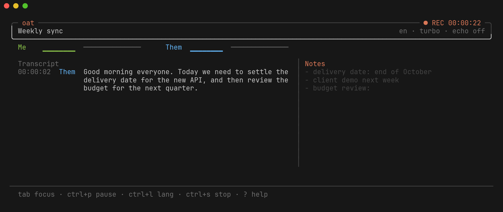

# oat

<p align="center"><b>Meeting notes in your terminal, transcribed and summarized with the Claude Code you already use.</b></p>

<p align="center">
  
</p>

oat records any meeting on Linux: Google Meet, Zoom, Teams, or a call in the browser. It captures your microphone and the system audio as two separate streams, so the transcript knows who said what. You type rough notes next to the live transcript. When the meeting ends, Claude Code merges your notes with the transcript into a clean summary.

oat needs no new account and no API key. The transcription uses the speech-to-text service of the Claude Code voice mode, with the login that Claude Code already has. The summary runs in Claude Code through an MCP server. If Claude Code works on your machine, oat works too.

- No keys to manage: `oat doctor` finds your Claude Code login and tests it.
- Two audio streams that never mix, "Me" and "Them", plus echo cancel for speakers.
- Plain files: each meeting is a folder of Markdown and JSONL on your disk.
- Each audio chunk goes to disk before it goes to the network, so a crash loses at most 30 seconds.
- Claude Code can answer questions about past meetings, such as "what did they decide about the budget last week?"

## Quick start

Download the static binary for Linux on x86-64:

```sh
curl -fsSL -o ~/.local/bin/oat https://github.com/matheuscamposmt/oat/releases/latest/download/oat-linux-amd64
chmod +x ~/.local/bin/oat
oat setup         # registers the MCP server in Claude Code
oat doctor        # tests the audio, the Claude login, and the MCP server
oat new "Weekly sync"
```

Or build it from source with `make install` (see [Install](#install)).

Press `ctrl+s` to stop. Then run `/mcp__oat__enhance` in Claude Code to get the summary.

This is an early version. It runs on Linux only and was tested on Pop!_OS 22.04 with PipeWire.

## How it works

`oat new "Title"` starts a recording. Two `parec` processes capture the mic ("Me") and the monitor of your default output ("Them"). The two streams never mix, so the transcript knows who said what.

Each stream is cut at pauses into chunks of 10 to 30 seconds. Chunks without speech are not sent. oat sends each chunk over its own connection to the Claude Code voice stream, as fast as the connection takes it, and gets the text back in about 3 seconds. A line shows up in the transcript about 10 to 30 seconds after it was said, because oat waits for the pause that ends the chunk.

The voice stream gives text without times. oat splits the text of a chunk into sentences and gives each sentence a part of the chunk in proportion to its length. The times in the transcript are therefore estimates inside each chunk.

While the meeting runs you type notes in the right pane. Notes are saved 2 seconds after you stop typing, and each audio chunk is written to disk as soon as it is cut, so a crash loses the audio still in memory (under 30 seconds) and nothing else.

`oat mcp` gives an MCP client access to the meetings. In Claude Code, `/mcp__oat__enhance` asks Claude to merge your notes with the transcript, in the style of Granola, and save the result as `summary.md`.

Audio chunks go to the voice endpoint at api.anthropic.com (or to Groq, with `transcriber = "groq"`) and are deleted once they are transcribed. Anthropic does not document which service transcribes the audio behind that endpoint. Set `keep_audio = true` to keep the chunks. Transcripts, notes, and summaries stay on your disk.

## Requirements

- Linux with PipeWire (and its Pulse layer) or PulseAudio
- `parec` and `pactl`, from the `pulseaudio-utils` package
- Go 1.25 or later to build. Go 1.24 downloads 1.25 on its own.
- Claude Code, logged in with a claude.ai account. With `transcriber = "groq"`, a Groq API key instead.

## Install

With the default backend, oat reads the claude.ai token from `~/.claude/.credentials.json` (or `$CLAUDE_CONFIG_DIR/.credentials.json`). Run `claude` once and log in. oat never writes that file and never renews the token. Claude Code renews it when it runs.

To use Groq, set `transcriber = "groq"` and give oat your Groq key in one of two ways. Export it in your shell:

```sh
export GROQ_API_KEY=gsk_...
```

Or put it in `~/.config/oat/config.toml` and keep the file readable by you only:

```toml
groq_api_key = "gsk_..."
```

```sh
chmod 600 ~/.config/oat/config.toml
```

Then build and install:

```sh
git clone https://github.com/matheuscamposmt/oat
cd oat
make install
oat doctor
```

`make install` builds a static binary into `~/.local/bin/oat` and runs `oat setup`, which registers the MCP server in Claude Code at user scope. `oat doctor` checks the audio stack, the Claude login and the voice stream (or the Groq key), the MCP registration, and the data folder. It prints a fix under anything that fails.

`go install github.com/matheuscamposmt/oat/cmd/oat@latest` also works. Run `oat setup` yourself afterwards. With that install, `oat version` prints `dev`.

## Record a meeting

```sh
oat new "Weekly sync"             # Portuguese by default
oat new "Weekly sync" --lang en
oat                               # the list of past meetings; press n to start one
```

The notes pane has the focus when the recording starts, so you can type right away.

| Key | Action |
|---|---|
| `tab` | Move the focus between the transcript and the notes |
| `ctrl+p` | Pause or resume |
| `ctrl+l` | Change the language for the next chunks: `pt`, `en`, `auto` |
| `ctrl+s` | Stop and save |
| `ctrl+c` | Stop and save, after a yes/no question |
| `?` | Show the keys (in the transcript pane) |

After you stop, oat uploads the last chunks. If you quit before that is done, the next start of oat finishes it.

## Ask Claude about your meetings

In Claude Code, ask something like "what did they say about the budget in the last meeting?". Claude has these tools:

| Tool | Purpose |
|---|---|
| `list_meetings` | Lists the meetings, newest first |
| `get_meeting` | Reads the notes, the summary, and the transcript. The ID `live` reads the recording in progress |
| `search_meetings` | Finds text in all transcripts and notes |
| `save_summary` | Saves meeting notes as `summary.md` |

To get the summary, run `/mcp__oat__enhance`. Any other MCP client that can start a stdio server can use `oat mcp` the same way.

## Echo

With speakers, the microphone also hears the other people, so their words show up twice. oat handles this in two layers.

The first is the PipeWire echo-cancel module. In the default `auto` mode, oat loads it for every output except headphones. While oat records, your default output is `oat_ec_sink`. oat restores the old output when you stop. If oat crashes, the next start (or `oat doctor`) removes the module.

The second is a text filter that drops a "Me" line when it repeats a "Them" line from the same seconds.

## Configuration

`~/.config/oat/config.toml` is optional. These are the keys and their defaults:

```toml
transcriber = "claude"             # claude or groq
lang = "pt"                        # ISO 639-1 code, or "auto"
model = "whisper-large-v3-turbo"   # Groq only: or "whisper-large-v3"
echo = "auto"                      # auto, on, off
keep_audio = false                 # keep the WAV chunks in audio/
groq_api_key = ""                  # Groq only: used when GROQ_API_KEY is not set
```

The flags `--transcriber`, `--lang`, `--model`, `--echo`, and `--keep-audio` override the file.

## Files

Each meeting is a folder in `~/.local/share/oat/meetings/`:

| File | Content |
|---|---|
| `meta.json` | Title, start, end, language, model, status |
| `transcript.jsonl` | One raw segment per line |
| `transcript.md` | The readable transcript |
| `notes.md` | Your notes |
| `summary.md` | The notes Claude wrote |
| `chunks/` | Audio waiting for the transcription service |
| `failed/` | Audio that the transcription service refused |
| `audio/` | Audio kept with `keep_audio = true` |
| `.lock` | The PID of the process that is recording |

## The Claude voice stream

oat uses `wss://api.anthropic.com/api/ws/speech_to_text/voice_stream`, the endpoint of the Claude Code voice mode. Anthropic does not document it, so keep these limits in mind:

- The endpoint can change or close in any Claude Code release. If `oat doctor` shows `✗ Claude voice`, set `transcriber = "groq"`.
- oat uses the claude.ai login of Claude Code outside Claude Code. Read the terms of your plan before you use it.
- The endpoint can drop the last words of a chunk that ends in the middle of a sentence.
- If the token expires during a meeting, the chunks wait on disk and oat tries again. Open Claude Code to renew the token.

## Groq limits

The Groq free tier caps the audio seconds per hour. Two streams can send up to twice the length of the meeting, which is why oat skips chunks with less than a second of speech. When Groq rate-limits a request, the HUD shows how long it waits.

## License

MIT. See `LICENSE`.
